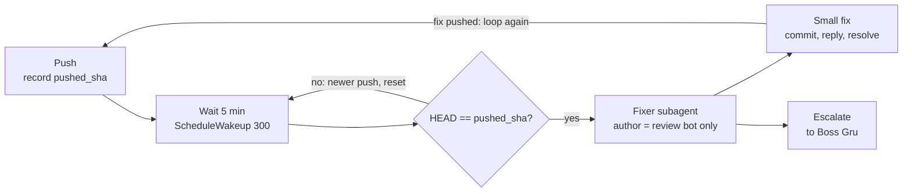

# How /go works

> Examples use `PROJ-1234`. `{{…}}` values are the placeholders you fill in during setup — see [SETUP.md](SETUP.md).

`/go` takes a ticket to a reviewed draft PR. The main session only coordinates: it reads the
ticket, grills you on the design, writes a plan, hands implementation to subagents, opens a draft
PR, gets it reviewed, and sweeps up review-bot comments (e.g. Cursor BugBot). It calls you "Boss Gru".

```
/go PROJ-1234
/go PROJ-1234 fix-auth
/go add retry to the queue consumer
/go PROJ-1234 autopilot
```

## How it reads what you typed

| Input | Effect |
|---|---|
| `autopilot` (anywhere) | Removed, and the mode becomes AUTOPILOT. Otherwise the run is INTERACTIVE. |
| `{{TICKET_PREFIX}}-\d+` | TICKET flow. Leftover words become a kebab-case branch suffix, e.g. `PROJ-1234-fix-auth`. |
| anything else | QUICK WIN flow. The text is the task; `/go` creates a ticket for it first (with your `{{TICKET_DEFAULTS}}`). |

## Who does what

| Who | Agent | Job |
|---|---|---|
| **Orchestrator** | main session | Coordinates only. Keeps raw exploration and review output out of its own context. |
| **Bob** | `ticket-planner` | Fetches the ticket: summary, description, acceptance criteria, links, priority. |
| **Carl** | `plan-reviewer` (opus) | Checks the written plan against the real codebase once. Returns CLEAN, RISK or BLOCKER. |
| **Implementers** | fresh subagent per task | haiku for mechanical work, sonnet for integration, opus for design judgment. |
| **Kevin** | `reviewer` (opus) | High-effort review of the pushed branch. Reports findings, never edits code. |
| **Explore / review-bot fixer** | `Explore`, `general-purpose` | Answer codebase questions during the grill; fix small `{{REVIEW_BOT_LOGIN}}` comments after pushes. |

## The steps

### 0. Check the model — *orchestrator*
- Says which model the session runs on and recommends Opus for planning.
- If it isn't Opus, asks whether you want to switch (you run `/model`) and waits. Asks for a ticket
  ID if none was given.
- **Autopilot:** states the model in one line and moves on.

### 1. Pick the target repo — *orchestrator*
- Offers the current repo first, then every `{{WORKSPACE_ROOT}}/*` repo, then "Other".
- **Autopilot:** uses the current repo.

### 2. Fetch the default branch and create a worktree — *orchestrator*
- Quick win only: runs `/create-ticket <description>` with your `{{TICKET_DEFAULTS}}`, and uses the new ID.
- From the main checkout: `git fetch origin {{DEFAULT_BRANCH}}`, then
  `git worktree add ../worktrees/PROJ-1234 origin/{{DEFAULT_BRANCH}} -b PROJ-1234`.
- Adds `docs/superpowers/` to `.git/info/exclude` so plan docs never land in the PR.
- Never `git checkout` or `git switch`. Every later command and subagent brief uses the worktree path.

### 3. Read the ticket — *Bob*
- Bob returns the ticket's summary, description, acceptance criteria, links and labels; `/go`
  presents a short summary.
- Quick win skips Bob: your description is the ticket.
- If Bob can't reach the tracker, asks you to paste the ticket.
- **Autopilot:** if the ticket is unavailable, stops and reports. There is nothing to build from.

### 4. Grill the design — *orchestrator + Explore*
- Runs the `mattpocock-skills:grilling` interview, keeping `CONTEXT.md` current through
  `domain-modeling`.
- One question per message, always with a recommended answer. Overrides the skill's "whole frontier
  at once".
- Anything the code can answer goes to an Explore subagent instead of you.
- Asks early for relevant files, prior PRs, and a similar feature to study; a subagent turns that
  feature into a checklist of what the new one might be missing.
- Offers an ADR only if a decision is hard to reverse, surprising, and a real trade-off.
- **Gate:** no plan until you confirm shared understanding.
- **Autopilot:** skipped. Each open decision takes the smallest-blast-radius option and is recorded
  under *Assumptions* in the plan and PR body.

### 5. Write the plan, then Carl checks it — *orchestrator + Carl*
- `superpowers:writing-plans` writes to `docs/superpowers/plans/`: small, mostly independent tasks,
  each executable by a subagent with no session context.
- The plan opens with a handoff block (execute, open draft PR, Kevin review, review-bot pass) so a fresh
  session can pick it up.
- Carl reviews once. CLEAN continues; RISK folds his mitigations into the named tasks; BLOCKER goes
  to you.
- Asks: execute here (default) or hand off to a fresh session? Waits 3 minutes via
  `ScheduleWakeup`, then defaults to executing here.
- **Autopilot:** on a BLOCKER, applies Carl's simpler alternative (stops if that blocks too). Always
  executes here.

### 6. Execute with subagents — *implementers*
- `superpowers:subagent-driven-development`: a fresh implementer per task, spec and quality review
  after each, fix subagents for Critical/Important findings.
- Every dispatch names its model explicitly. No "should I continue?" check-ins between tasks.
- Small fixes (single file, no new abstraction, no contract change) skip re-review, noted in the
  ledger.
- A final whole-branch review checks plan compliance. It does not replace Kevin.

### 7. Open the draft PR, then Kevin reviews — *orchestrator + Kevin*
- Commits with Conventional Commits (`feat(scope): PROJ-1234 …`), pushes, and runs
  `gh pr create --draft`. Never asks first.
- The PR opens before review so CI starts immediately. Grill decisions and assumptions go in the
  body.
- Kevin reviews the branch at high effort. Fix subagents address his findings; large or
  architectural ones come to you.
- The fix commit push starts the review-bot timer.
- **Gate:** not done until the PR is open and Kevin has reviewed it.

### 8. Sweep review-bot comments — *general-purpose*
- Five minutes after the latest push, a subagent fixes comments from `{{REVIEW_BOT_LOGIN}}`
  only. Human and other bot comments are left alone.
- Only small, local fixes are applied; the rest are escalated to you with a recommendation.
- Ends with the PR URL and any escalated items.

## The review-bot loop restarts on every push

The timer always runs from the most recent push. If anything lands during the wait, that pass is
thrown away and the clock starts over, so the bot is never answered against a stale diff.



## Where interactive and autopilot differ

| Step | Interactive | Autopilot |
|---|---|---|
| 0 model | Asks whether to switch to Opus; waits | States the model, continues |
| 1 repo | Asks which repo | Current repo |
| 3 ticket | Asks you to paste it if the tracker fails | Stops and reports |
| 4 grill | One question at a time until you confirm | Skipped; smallest-blast-radius choices recorded as Assumptions |
| 5 Carl blocker | Presented to you | Carl's alternative applied; stops if still blocked |
| 5 handoff | Asks, defaults to "here" after 3 min | Executes here |

Autopilot never calls `AskUserQuestion`. Steps 2, 6, 7 and 8 run the same in both modes.

## Standing rules

- **Worktrees only.** Never `git checkout` or `git switch`. Every task gets its own worktree off a
  fresh `origin/{{DEFAULT_BRANCH}}`.
- **Main context stays clean.** Codebase questions go to Explore, code goes to implementers, reviews
  go to Kevin and Carl.
- **Every run ends in a PR.** Draft, opened without asking, unless you said earlier in the session
  not to push.
- **Review happens once.** Kevin's high-effort review is the only quality gate after
  implementation. The plan block's review line is the same review.
- **Waits never block.** `ScheduleWakeup`, or a background `sleep` if that tool is missing.
- **Missing minions run inline.** Where named agents aren't available (Cursor), the step follows the
  agent's file and says so.
